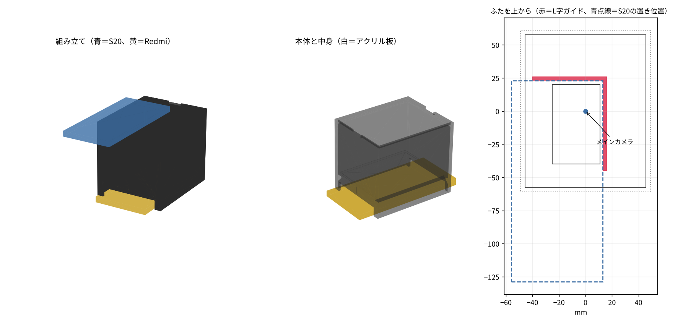

# 撮影ボックス v0（挽き目・焙煎度）

Galaxy S20（通常カメラ）で、挽いた粉を撮るための暗箱。下からの光には 2台目のスマホ（Redmi Note 11 Pro 5G）の白い画面を使う。

## 部品
| ファイル | 大きさ | 印刷の向き |
|---|---|---|
| `body.stl` | 98 × 122 × 105 mm | そのまま（底を下）。サポート不要（棚と段の下は45°） |
| `lid.stl` | 91.4 × 115.4 × 6.5 mm | そのまま（平らな面を下、L字ガイドを上）。サポート不要 |

ふたは本体の上端に落とし込む平らな板です（上面が本体の縁とそろう）。前後の壁の上端にある切り欠きに指をかけて持ち上げます。

- 素材：**黒**の PLA / PETG（中で光が反射しないように）
- 積層 0.2 mm、壁 3 周以上、インフィル 15% 程度
- 必要なもの：**乳白アクリル板** 厚さ 2〜3 mm、幅 80〜90 mm × 長さ 100〜115 mm

## 使い方
1. Redmi を画面を上にして机に置き、白い画面を最大の明るさで表示する
2. 本体を上からかぶせる（Redmi は前後の切り欠きからはみ出す。外面中央の刻みと Redmi の中心を合わせる）
3. アクリル板を棚に載せ、粉を少しずつ撒く
4. ふたを本体の上端に落とし込み、S20 を画面を上にして、右端と上端を L字ガイドに当てて置く
5. 焙煎度を見るときは Redmi の画面を消し、S20 のライトを点ける

## 主な寸法（変えるときは `grind_box_v0.py` の冒頭を編集して実行）
- レンズ〜試料面：約 80 mm（通常モードの最短ピント約 70 mm ＋ 余裕） → 1画素 ≒ 27 µm、写る範囲 ≒ 8 × 11 cm
- Redmi の画面〜アクリル板の下面：約 12 mm（画面の画素の粒々をぼかすため）
- S20 のメインカメラ位置：背面から見て上端 23 mm・左端 13 mm（ユーザー実測）
- カメラ窓：背面から見て 左端 2〜38 mm、上端 3〜63 mm（ライトも含む想定。合わなければ `WIN_D` / `WIN_T` を変更）

## 未確認の点（印刷後に確かめる）
- S20 のライトが窓の範囲に入っているか
- Redmi 背面のカメラの出っ張りで画面が傾かないか（傾くなら薄い板を下に敷く）
- 80 mm でピントが合うか（合わなければ `WORK_DIST` を調整）
- S20 のライトが試料面でテカらないか（テカる場合は窓に薄い白い板を足す）

再生成：`pip install manifold3d trimesh` → `python grind_box_v0.py`
