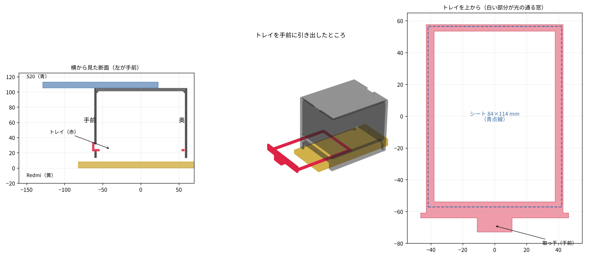

# 撮影ボックス v1（引き出し式トレイ）

v0 の箱に、**手前から引き出せる試料トレイ**を付けたものです。粉を落とすときに、ふたや S20 をどけたり、箱ごとひっくり返したりする必要がなくなります。

## 部品
| ファイル | 大きさ | 印刷 |
|---|---|---|
| `body.stl` | 98 × 122 × 105 mm | 印刷し直し。手前の壁にトレイの出し入れ口が開いた。向き・設定は v0 と同じ（サポート不要） |
| `tray.stl` | 93 × 131 × 12 mm | 新しい部品。そのまま（平らな面を下）。サポート不要 |
| `lid.stl` | 91.4 × 115.4 × 6.5 mm | **v0 と同じ**。今のふたをそのまま使える |

- 素材：黒の PLA / PETG
- 「手前」は S20 の下端（充電口）側です。トレイの取っ手はこちらに出ます

## トレイの準備
1. クリアファイルを **84 × 114 mm** に切る（トレイ上面のくぼみの大きさ）
2. トレイの縁（左右の細い部分と前後の縁）に細い両面テープを貼り、シートをしわが出ないように貼る
3. シートの上面がトレイの上面とそろうので、傾けると粉が引っかからずに落ちる

乳白アクリルを買ったら、`grind_box_v1.py` の `SHEET_T` をその厚み（例 2.0）にして実行すると、アクリル用のトレイが作れます（試料面の高さは変わりません）。

## 使い方
1. Redmi を置き、本体をかぶせ、ふたと S20 を載せる（ここまでは v0 と同じ。以後そのまま）
2. 取っ手を持ってトレイを引き出し、粉を撒いて、奥まで押し込む（前板が壁に当たるところまで）
3. 撮る
4. トレイを引き出し、カップの上でひっくり返して軽く叩く。残った粉はブロワーで吹く

## 注意
- **粉を置く高さが変わる**（今までの Redmi の画面の上 → トレイの上。カメラに約 15 mm 近づく）ので、1画素の大きさも変わります。トレイの上に硬貨を置いて撮り、大きさを合わせ直してください。アプリの「方眼で大きさ合わせ」は Redmi の画面の高さで測る仕組みなので、トレイを使うときは使わないでください
- 出し入れ口は、試料面の上に 6 mm のすき間を取ってあります（撒いた粉が口の縁でこそげ落とされないように）。前板が口のまわりに 3 mm 重なって外の光をふさぎます。口の下端は棚の上面と同じ高さなので、下からも光は入りません

## 主な寸法
- 試料面の高さ：25 mm（v0 のアクリル上面と同じ）。レンズ〜試料面 約 80 mm
- トレイの窓（光が通る範囲）：76 × 108 mm
- 出し入れ口：87 × 9 mm（トレイの厚み 3 mm ＋ 粉が通る高さ 6 mm。横のすき間は片側 0.5 mm）

再生成：`pip install manifold3d trimesh` → `python grind_box_v1.py`（図は `python render.py`）

## 修正履歴
- 2026-10-30：出し入れ口の高さを 3.4 mm → 9 mm に変更（最初の版は、粉の高さと印刷の誤差（口の上端の垂れ下がり）を見込んでおらず、トレイが入らない・粉がこそげ落とされる問題があった）。トレイの前板と取っ手も合わせて高くした。横のすき間を 0.4 → 0.5 mm に
