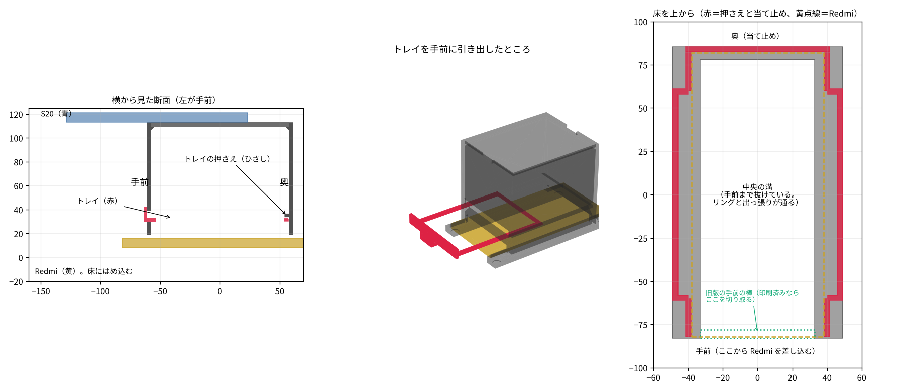

# 撮影ボックス v2（Redmi をはめ込む床つき）

v1（引き出し式トレイ）に、**Redmi を画面を上にしてはめ込む床**を付けたものです。Redmi・箱・トレイがひとかたまりになるので、カメラ側から Redmi を振動させると、その振動がトレイの粉まで伝わります。

## 部品
| ファイル | 大きさ | 印刷 |
|---|---|---|
| `body.stl` | 98 × 169 × 113 mm | 床を下にしてそのまま。サポート不要 |
| `tray.stl` | 93 × 131 × 12 mm | v1 と同じ形（v1 のトレイをそのまま使える） |
| `lid.stl` | 91.4 × 115.4 × 6.5 mm | v0 / v1 と同じ（今のふたを使える） |

## 床のつくり
- **床の中央は幅 66 mm の溝で、手前まで抜けています**（手前に棒はありません）。Redmi の背面は左右 5 mm の縁と奥の 4 mm の縁で支えます。差し込むとき、背面リング（バンカーリング）とカメラの出っ張りはこの溝の中を通ります
- 床の縁の高さは **8 mm**。折りたたんだリングが 8 mm までなら、ゴム足なしでも机に当たりません
- 左右の押さえは、側面のボタンに当たらないよう **Redmi の両端 22 mm ずつ**だけにしてあります
- 手前は開いていて、奥に当て止めがあります。Redmi を手前から奥まで差し込んでください
- **奥の壁の内側に、トレイを押さえるひさし**（張り出し 4 mm、トレイ上面とのすき間 0.6 mm）があります。差し込んだトレイの奥が持ち上がりません。トレイの奥の上の角は 1 mm 面取りしてあり、ひさしの下へ滑り込みます
- 床の裏の四隅にある丸いくぼみ（直径 10 mm）に、振動を机に吸われないための **ゴム足** を貼ると効果的です（高さは問いません）

## 使い方
1. Redmi で Coffee Lab の「ライト」を開いてから、画面を上にして手前から奥まで差し込む
2. ふたと S20 を載せる
3. トレイに粉を撒いて差し込み、カメラ側の「背景：…」→「振動」で粉をならす
4. 振動が止まってから撮る

## 注意
- 床のぶん、全体が 8 mm 高くなりました（試料面 z = 33 mm）。カメラから試料面までの距離（80 mm）は v1 と同じなので、**1画素の大きさは v1 と同じ**です
- Redmi が押さえに対してきつい・ゆるいときは `REDMI_CLR` を、リングが穴に当たるときは `RING_HOLE_W` を変えて作り直してください

再生成：`pip install manifold3d trimesh` → `python grind_box_v2.py`（図は `python render.py`）

## 印刷済みの本体（10/30 夕方より前の版）の直し方
作り直さずに直せます。
1. **手前の棒を切り取る**：床の手前の端にある、左右の縁をつないでいる棒（幅 66 mm・奥行き 5 mm・高さ 8 mm）を、左右の縁との境目の 2 か所でのこぎりかニッパーで切り落とす（`preview.png` 右の緑の点線）。左右の縁は残す
2. **ひさしを貼る**：`retrofit_lip.stl`（80 × 12 × 4 mm の L 字。大きい面を下にしてサポートなしで印刷）を印刷する
   - トレイを奥まで差し込み、トレイの奥の縁の上にクリアファイルの切れ端を 3 枚重ねて置く（すき間 0.6 mm の代わり）
   - その上に部品を、短い張り出しを下・幅 12 mm の面を奥の壁に向けて載せ、壁に押し当てて瞬間接着剤か強力両面テープで貼る
   - 固まったらクリアファイルを抜き、トレイが引っかからずに出し入れできることを確かめる

## 修正履歴
- 2026-10-30（夕方）：① 床の手前の棒をなくし、中央の溝を手前まで抜いた。差し込むときにリングとカメラの出っ張りがこの棒に当たって入らなかった（前回の「差し込む途中も当たらない」確認は、Redmi 本体だけを動かしていて、リングと出っ張りを一緒に動かしていなかった）。② トレイの奥が持ち上がるため、奥の壁にトレイを押さえるひさしを追加し、トレイの奥の上の角を面取り。印刷済みの本体用に後付けの `retrofit_lip.stl` を追加
  - 確認：リング・出っ張り付きの Redmi を手前の外から最終位置まで 1 mm ずつ動かし（出っ張り 4 通り × リング位置 5 通り × 213 位置）、本体と重ならないことを計算した。直す前の形では同じ計算でリングが手前の棒に当たることも確かめた。トレイは出し入れの全区間で重ならず、奥を 0.7 mm 持ち上げるとひさしに当たる
- 2026-10-30：床を見直し。カメラの出っ張りを考えていなかったため Redmi が傾くおそれがあった → 床の穴を 66 × 156 mm に広げ、床の高さを 8 mm にしてリングが机に当たらないようにした。押さえのすき間を片側 0.25 → 0.4 mm（印刷の誤差込み）、Redmi を通す切り欠きの余裕を 1.5 → 2.5 mm に
  - 確認：Redmi（76.1 × 164.2 × 8.12 mm）＋カメラの出っ張り（28 × 44 × 2.5 mm、四隅どこでも）＋背面リング（45 × 45 × 8 mm、中心から前後 ±50 mm）の組み合わせ 20 通りと、手前から差し込む途中のすべての位置で、本体・トレイとぶつからないことを計算した
- 2026-10-30：出し入れ口の高さを 3.4 mm → 9 mm に変更（最初の版は、粉の高さと印刷の誤差（口の上端の垂れ下がり）を見込んでおらず、トレイが入らない・粉がこそげ落とされる問題があった）。トレイの前板と取っ手も合わせて高くした。横のすき間を 0.4 → 0.5 mm に
